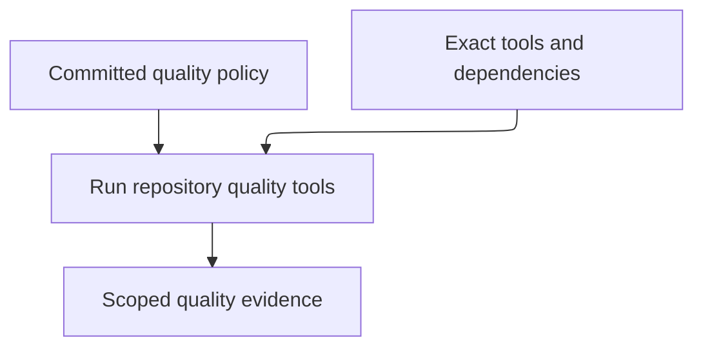
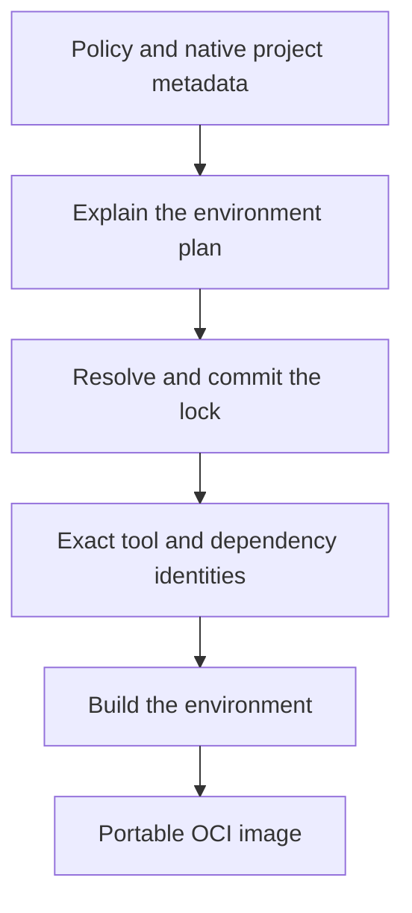

# How Ayni works

Ayni measures repository code against an explicit quality contract. It integrates
language tools and can package their locked versions into a development image.
These responsibilities meet when a signal executes.



That separation gives reviewers three explicit questions instead of one opaque script:

1. Which measurements and thresholds define a healthy repository?
2. Which exact tools and dependencies produce those measurements?
3. Which scope should be measured for this feedback cycle?

## Product responsibilities

| Responsibility | What Ayni provides |
| --- | --- |
| Signals | Normalized measurements and actionable findings |
| Tool compatibility | Adapter integrations and version inventories, with an exact-combination qualification policy planned |
| Quality contracts | Repository-owned measurements, thresholds and completion requirements |
| Managed environments | Locked runtimes, tools and prepared dependencies in an OCI development image |
| Evidence | Results tied to policy, source and recorded execution context |

These are product responsibilities, not implementation crate layers.
[Runtime and tool compatibility](/product/compatibility) explains the difference
between locking exact versions and qualifying them together.

## The quality contract: what is healthy?

`.ayni.toml` is repository policy. It defines:

- which languages and roots Ayni evaluates;
- which signals are enabled;
- warning and failure thresholds;
- structural dependency rules;
- concurrency and report controls;
- optional tool-command overrides.

Native tool configuration remains project-owned. Platforms own container launch
policy, network access, Docker sockets and resource limits.

The contract is deterministic and versioned with the code. `ayni contract show` validates its shape while rendering the effective policy.

## Signals: what is measured?

A signal turns repository state into normalized evidence. Ayni currently models:

| Signal | Question |
| --- | --- |
| Tests | Does expected behavior pass? |
| Coverage | How much code is exercised? |
| Size | Which files exceed repository limits? |
| Complexity | Which functions exceed structural limits? |
| Dependencies | Do source dependencies respect architectural rules? |
| Mutation | Do tests detect injected behavioral changes? |

Adapters own language-specific command selection and evidence parsing. The contract remains language-neutral at the signal level, while [capability tiers](/product/capabilities) state where a signal is supported, experimental, or unavailable. Ayni refuses unavailable signals rather than substituting a proxy measurement.

Signals have `pass`, `warn`, or `fail` status. A warning threshold provides feedback without failing the gate. Failure-level findings, tool failures, or missing expected results fail the complete contract.

## The managed environment: where does it run?

A managed environment is derived from:

- configured language roots;
- enabled signals and the tools they require;
- native project metadata and dependency locks;
- repository-wide environment configuration; and
- an immutable Ayni base-image digest.

`ayni env show` explains that derived plan without modifying state. `ayni env lock` resolves it into `.ayni.lock`, and `ayni env build` turns the lock into an OCI image with prepared dependencies.



Ayni does not silently lock or rebuild during a quality run. Changes to versions, dependencies, tools, capabilities, or preparation inputs therefore remain visible in the lock and image lifecycle.

## Execution: what runs now?

The command chooses scope; Ayni and the adapter choose the exact signal command.

| Command | Scope | Execution environment |
| --- | --- | --- |
| `ayni check` | Every enabled signal across all configured targets | Current workspace |
| `ayni verify <signal>` | One signal, optionally narrowed to a language, root, file, package, or test | Current workspace |
| `ayni impact run --base <revision>` | Quality work affected by an explicit Git change | Current workspace |

Before collecting, Ayni verifies image metadata when it is present, selects the language target, runs the adapter command, parses its output, applies contract thresholds, and writes normalized evidence. Without image metadata it uses locally installed tools and reports actionable setup failures.

## The reviewable repository boundary

A reproducible Ayni setup has several versioned inputs:

| Input | Purpose | Commit it? |
| --- | --- | --- |
| `.ayni.toml` | Quality policy and environment inputs | Yes |
| `.ayni.lock` | Exact managed environment resolution | Yes |
| Native tool metadata | Toolchain selectors such as `rust-toolchain.toml`, `packageManager`, or Gradle JVM configuration | Yes |
| Native dependency locks | Exact project dependencies | Yes |
| `.ayni/` | Local evidence, history, and materialized runtime state | No |
| OCI image | Local executable environment derived from the lock | No |

The CLI installation itself is machine-level tooling. Installing or upgrading `ayni` does not provision a repository environment or change these files.

## The normal lifecycle

The build step supports unsigned metadata. Configure both
[environment certificate signing variables](/product/environments#signing-an-environment-image)
when a repository-pinned signing identity is required.

```sh
# Policy work
ayni init --dry-run
ayni contract show
ayni env show

# Rebuild only when environment inputs change
ayni env lock
ayni env build
ayni env doctor

# Daily quality loop
ayni verify test
ayni impact run --base origin/main
ayni check
```

The full check evaluates completion against the repository contract. Tests and
external inputs can vary even when policy evaluation is deterministic.
Environment verification, passing quality and authenticated evidence remain
separate claims; see the [security model](/product/security).

## Next steps

- Follow the [Quickstart](/getting-started/quickstart) for the first repository setup.
- Read [Managed environments](/product/environments) for lock and runtime details.
- Read [Signals](/product/signals) for evidence semantics.
- Read [Runtime and verification](/product/runtime) and [Impact analysis](/product/impact) for focused execution.
