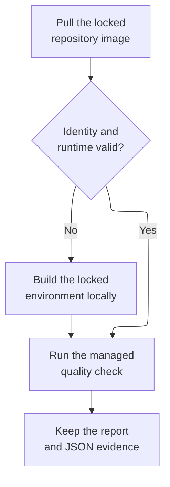

# Development environments

Ayni has two separate responsibilities. `ayni check`, `ayni verify`, and
`ayni impact run` run in the current checkout using its current execution
environment. `ayni env build` produces a reusable OCI development image.

Quality commands never build, launch, or re-execute a container. On a host,
missing tools produce setup guidance. In an Ayni image, `/etc/ayni/runtime.json`
is verified against the attached checkout's lock and protected tool inventory
before locked tool activation is applied.

Docker and Podman image identities are retained as canonical `sha256:` digests.
Podman's bare SHA-256 inspection output is normalized before checking a newly
built image, restoring a prior tag, or validating a retained build record.

## Reusing an environment in CI

The [managed-check action](https://github.com/ayni-oss/ayni/tree/main/.github/actions/managed-check)
looks for `ghcr.io/<owner>/<repository>:ayni-<lock fingerprint>` before building.
The tag uses all 64 fingerprint characters, without the `sha256:` prefix.
Supply the Ayni executable that CI intends to test; cached images must contain
those exact bytes. A matching version number alone is insufficient.



The action validates the platform, lock, executable and runtime certificate,
then uses an immutable image ID for the quality run. Missing or rejected images
fall back to the existing local build. Quality failures remain failures and
retain their evidence; they do not cause a second build. The action only reads
the registry and never publishes an image. Pin external action uses to a
reviewed commit SHA and upload the report and `.ayni/last/signals.json` even
when a check fails.

## Lifecycle

```sh
ayni env show
ayni env lock
ayni env build
```

`env lock` is explicit and writes the committed `.ayni.lock`. `env build`
requires that current lock and never refreshes it. `env doctor`, `env storage`,
and `env prune` diagnose and maintain existing environment state. Use ordinary
container or platform tooling to start the image.

Builds do not push images. `--tag` adds a local image tag. With neither signing
variable set, Ayni writes unsigned metadata that establishes local consistency.
With both `AYNI_ENV_CERTIFICATE_SIGNING_KEY` and
`AYNI_ENV_CERTIFICATE_KEY_ID` set, Ayni signs the same metadata and verifies the
configured repository trust key. Supplying only one signing value fails.

## Building in Kubernetes

Use `ghcr.io/ayni-oss/ayni-builder:<version>` as the factory Job image. Attach a
checkout with a current `.ayni.lock` and configure Docker access to an external
engine. The builder contains Ayni, Docker CLI, Buildx, Git and CA certificates;
it contains no daemon or project language runtimes. Docker-compatible build,
image inspection and container execution are required for certification.

Run `ayni env build --repo-root /workspace`. The output is a separate repository
image, not an installation into the factory container. Mise and the locked tools
run inside its generated build stages. Supply the signing variables for signed
certification. Publish the result separately using the build record's image tag.
Start agents in containers from that resulting image.

The CLI also runs directly on a host. Building an existing lock does not require
host Mise or project toolchains; Docker/Buildx and an engine provide the build and
validation operations. Resolving a new lock with `ayni env lock` requires Mise.

## Signing an environment image

Use an Ed25519 key dedicated to environment-image signing. Ayni expects the
private value as a **32-byte seed encoded as 64 lowercase hexadecimal
characters**; it does not accept a PEM private key. Keep that seed only in a
trusted secret store or trusted CI environment.

The following commands generate a seed with OpenSSL, derive its public key,
and print both values. Run them on a trusted machine and transfer the private
seed to the secret store without placing it in the repository:

```sh
private_key_file="$(mktemp)"
trap 'rm -f "$private_key_file"' EXIT

openssl genpkey -algorithm ED25519 -out "$private_key_file"
signing_seed="$(openssl pkey -in "$private_key_file" -outform DER | tail -c 32 | xxd -p -c 64)"
public_key="$(openssl pkey -in "$private_key_file" -pubout -outform DER | tail -c 32 | xxd -p -c 64)"

printf 'signing seed: %s\npublic key: %s\n' "$signing_seed" "$public_key"
```

Choose a stable key identifier and pin the public key in `.ayni.toml`:

```toml
[environment.certificate.trusted_keys]
release-2026 = "<64-character lowercase Ed25519 public key>"
```

Commit that policy change and refresh the lock:

```sh
ayni env lock
```

For a trusted build, set these two values together:

```sh
export AYNI_ENV_CERTIFICATE_SIGNING_KEY='<64-character lowercase signing seed>'
export AYNI_ENV_CERTIFICATE_KEY_ID='release-2026'
ayni env build
```

The key identifier must use only ASCII letters, numbers, `.`, `-`, or `_`.
`ayni env build` fails before building when the seed is malformed, only one
variable is set, or the derived public key does not match the pinned key.
Use neither variable for an unsigned build.

## Certifying an existing filesystem offline

`env certify` separates signing from image construction. It reads a frozen
filesystem snapshot, checks the reviewed lock and public trust policy, and emits
a signed metadata layer without running candidate programs, repository tools,
an image engine, or network requests. This supports building on one machine and
signing on another that has no build-engine access.

Obtain the expected protected-content root from reviewed unsigned-build evidence
and the expected Ayni executable digest from independently trusted executor
evidence. Keep those expectations outside the builder's writable storage. Do not
calculate new expectations from the candidate during certification: that would
approve a changed candidate instead of rejecting it.

```sh
ayni env certify \
  --repo-root /reviewed/source \
  --filesystem-root /snapshots/candidate \
  --platform linux/arm64 \
  --expected-ayni-sha256 sha256:<reviewed-executable-digest> \
  --expected-content-root sha256:<reviewed-protected-content-root> \
  --key-id release-2026 \
  --signing-key-file /private/environment.seed \
  --output /artifacts/certification-layer.tar
```

The source must contain the committed policy, lock, and referenced input files.
The explicit seed file must be a regular, non-symlink file containing 64 lowercase
hexadecimal characters, optionally followed by one newline. Keep it outside the
source and candidate filesystem. When inspecting `/` inside a container, keep
the key and output outside all protected roots and `/etc/ayni`. The command does
not read the build signing environment variables.

The caller must safely acquire the candidate filesystem and keep it immutable
and read-only throughout certification. Extraction and OCI-layer merging belong
to the caller; `env certify` does not unpack untrusted archives. Linux and macOS
are supported for inspection. This first implementation requires the selected
Linux platform to match the certifier's CPU architecture and the lock's supported
platforms. Neither a filename nor a candidate-provided version string establishes
the expected executable identity.

Protected reads use descriptor-relative traversal, reject escaping symlinks and
special files, and check for changes during inspection. Limits are 256 MiB per
regular file, 8 GiB of regular-file content, one million filesystem entries,
128 directory levels, and the existing 64 MiB manifest limit. Source reads allow
a 1 MiB lock, 512 KiB per other input, 256 files, and 8 MiB total. These checks supplement the immutable-snapshot requirement;
they do not provide isolation from a concurrently writable filesystem.

The output is an uncompressed tar layer containing only
`etc/ayni/runtime.json` and `etc/ayni/protected-content.manifest`, each with root
ownership and mode `0444`. Standard output is a JSON report containing its
SHA-256 layer digest and DiffID, certificate and content identities, selected
platform, public trust fingerprint, and image labels. It contains no signing
seed. Publish the layer without executing candidate image configuration, such
as `ONBUILD` instructions. Preserve existing candidate layers and configuration,
append the reported DiffID and layer descriptor, and apply the reported labels.

Output publication is atomic and never replaces a different existing file.
Repeating the same request against an unchanged snapshot returns the same layer
and report; a conflicting output fails. After interruption, retry with the same
reviewed inputs. A temporary file alone is not a completed certification artifact.

The caller must bind the final immutable image digest to this evidence and
independently verify the actual published filesystem and runtime permissions.
Certification signs reviewed protected bytes and their lock association. It does
not establish OCI publication, launcher isolation, passing source checks, or
fresh managed-execution compatibility.

## Launching an image

The image defaults to `/bin/sh`. A platform attaches the checkout at its chosen
working directory, then invokes native development tools or plain Ayni commands:

```sh
docker run --rm -it \
  --env HOME=/tmp/home --env XDG_CACHE_HOME=/tmp/cache \
  --env MISE_CACHE_DIR=/tmp/mise \
  --mount type=bind,source="$PWD",target=/workspace \
  --workdir /workspace \
  <image> /bin/sh

ayni check
```

The platform provides writable runtime cache directories and owns networking,
user identity, resource limits, and isolation.
Ayni records a verified environment context in its result artifact when runtime
metadata is present; it does not claim that the launcher isolated the workload.

## Prepared dependencies and project links

The image stores prepared outputs as protected archives, retaining their
project-relative directory layout. Certification covers the archive bytes and
preparation instructions, not the editable checkout's source files. Archives
are validated before certification: entries must belong to declared outputs,
and dependency links must resolve within the staged project. Links into project
source are recorded without copying that source into the image.

When started with a checkout containing `.ayni.lock` as its working directory,
the entrypoint verifies the runtime certificate, protected content, and lock
before restoring dependencies. It checks link chains against the actual checkout
too, rejecting source-directory symlinks that escape it. Absolute links within
the original staged project become relative links; external links, cycles,
archive traversal, and writes through archive symlinks are rejected. No
package-manager directory names are used to decide whether a link is safe.

Prepared outputs are restored in their original relative locations and the
adapter's offline materialization commands run once for that prepared checkout.
This supports both links between dependency trees and links to editable project
packages. Existing unrecognized output directories are never silently replaced.
Preparation is serialized per checkout; a successful marker allows later starts
to reuse its mutable outputs. A failed or interrupted preparation does not get a
success marker; use a fresh checkout or explicitly clean only the generated
outputs before retrying. Changing the environment lock likewise requires fresh
prepared outputs. The archives remain read-only in the image throughout.
